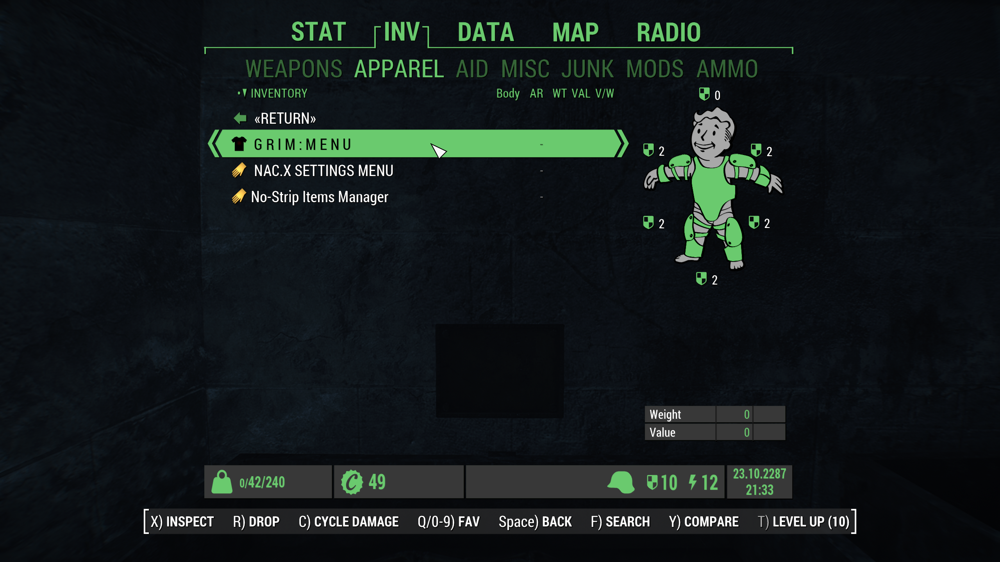
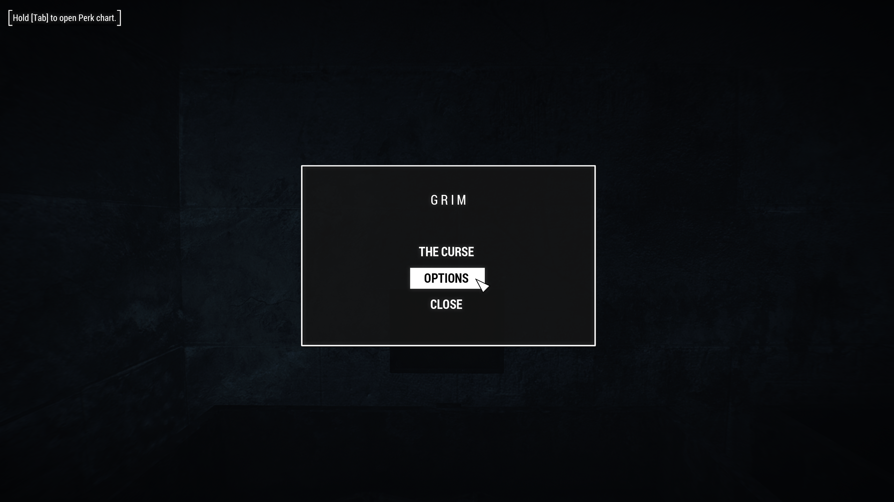
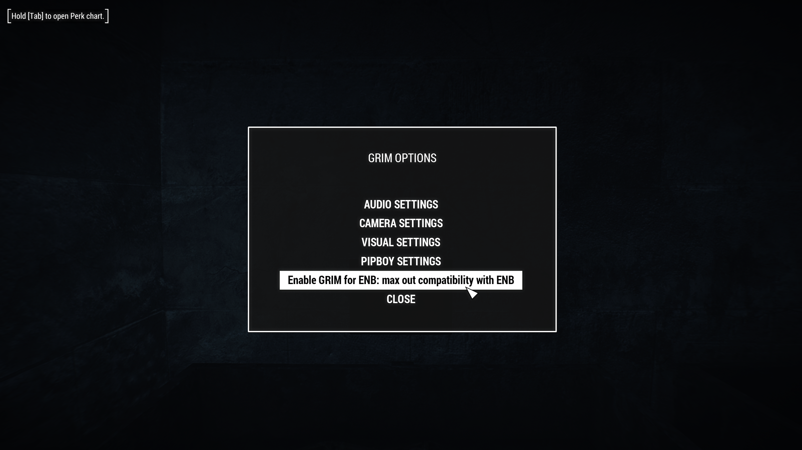
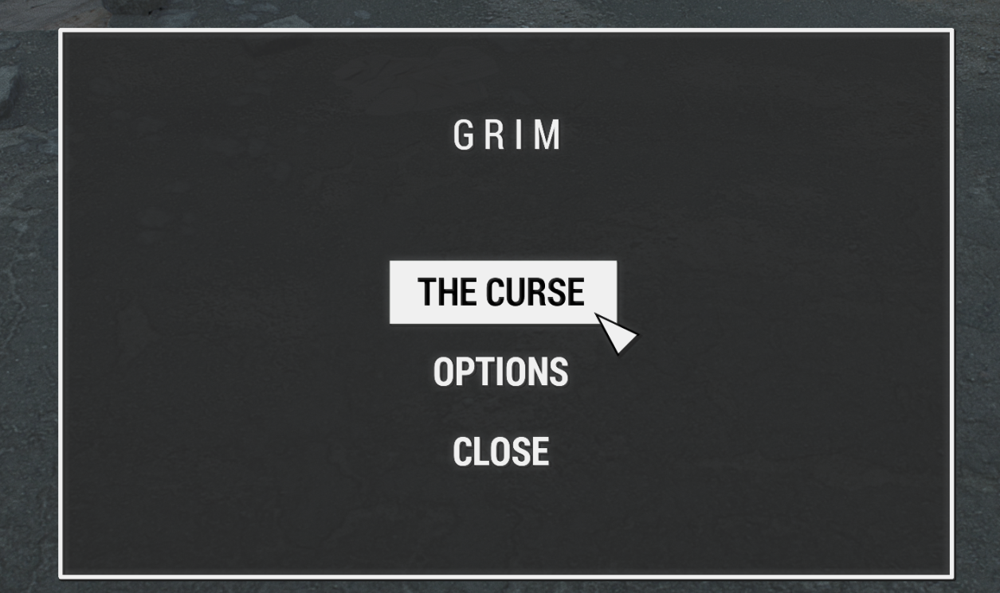

# Give Me Spoop Profile

## Profile Specific Setup
Follow the regular readme, up to the point of applying the MCM settings. After doing that, come back here and follow these additional steps:

1. Open your Pipboy menu, navigate to `Apparel` and find the `GRIM : MENU` item and then click it.

2. Close out of the Pipboy menu and in the GRIM menu that opens, click `OPTIONS`.

3. Click the `Enable Grim for ENB` option.

## If you want to play through the GRIM questline
1. Re-open the GRIM menu

2. Enable `The Curse`

3. Done!

## If you want to play through the Whispering Hills questline
You'll find it in your Quest menu already :^)

I would suggest you only do one of these questlines at a time. It can get a little overwhelming otherwise.