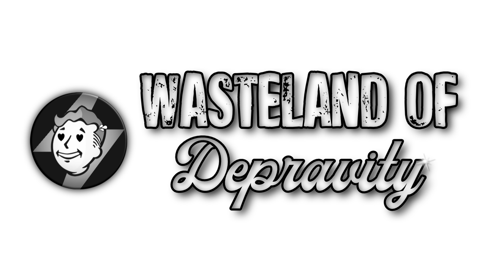
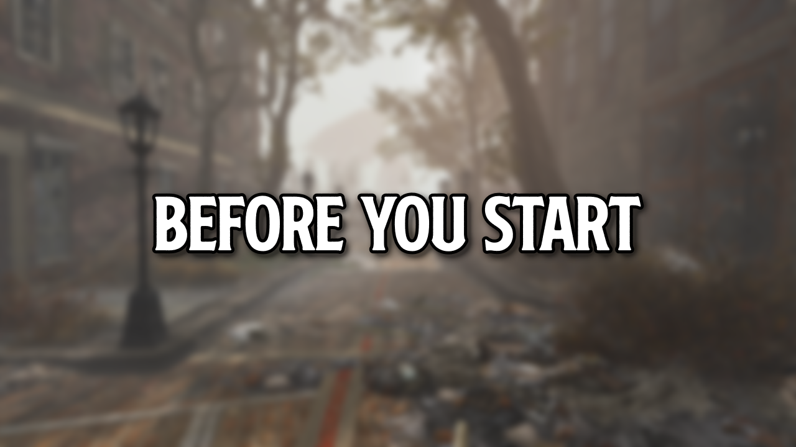
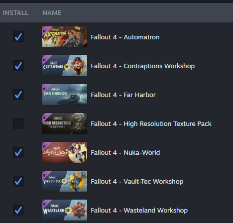

[ Getting Started ]
[ <a href="https://github.com/iAmMe27/WoD/blob/main/Installation.md">Installation</a> ]
[ <a href="https://github.com/iAmMe27/WoD/blob/main/PostInstall.md">After Install</a> ]
[ <a href="https://github.com/iAmMe27/WoD/blob/main/ModSetup.md">Mod Setup</a> ]
[ <a href="https://github.com/iAmMe27/WoD/blob/main/Controls.md">Controls</a> ]
[ <a href="https://github.com/iAmMe27/WoD/blob/main/CommonIssues.md">Common Issues</a> ] 

&nbsp;

**This list contains adult content and you must be of legal age in your country.  
This means 18+ in most countries, 21+ in others.  
It is up to you to be sure of the age requirement in your country.**

&nbsp;

# Content
- [Content](#content)
- [Quick Links](#quick-links)
- [Preface](#preface)
- [Getting Started](#getting-started)
  - [Hardware Requirements](#hardware-requirements)
  - [Storage Space](#storage-space)
  - [Accounts](#accounts)
  - [Fallout 4 Install](#fallout-4-install)
  - [DLC](#dlc)
- [Support](#support)
  - [What we do not support](#what-we-do-not-support)
    - [External SSDs and HDDs](#external-ssds-and-hdds)
    - [Linux](#linux)
    - [Controller](#controller)
    - [Male player character](#male-player-character)
  - [Asking for support in Discord](#asking-for-support-in-discord)
- [Support me?](#support-me)
- [Updating Wasteland of Depravity](#updating-wasteland-of-depravity)
- [Continuing](#continuing)

# Quick Links
:tv:  I have an Ultrawide monitor! >[CLICK ME](CommonIssues.md#i-have-an-ultrawide-monitor-help))<
  
:file_folder: Having issues with downloads in Wabbajack? [Check this page first.](https://github.com/iAmMe27/WoD/wiki)

:exclamation: **I have an issue with WoD!** >[CLICK ME](CommonIssues.md)<

# Preface
Just to set some expectations and boundaries surrounding modlist development here, there's a couple things I'd like to say first.

1. As a modlist user, I expect some small efforts into fixing your own issues, mostly by searching the documentation provided here and by the Discord channels. It's very likely any issue you encounter has already been solved - if this is the case and it's well known, don't be surprised if you get ignored.
   
2. Support shouldn't be expected as instant - I have a full time job on top of this, as do my mod team, so I ask for a little bit of patience.
   
3. Do not expect a 100% polished, well-balanced and "perfect" experience. I am a 1-person dev team and expecting more from me than you would from AAA game studios is insanity.
   
4. We're modding an 11 year old game here, please temper your expectations some.

# Getting Started

## Hardware Requirements

**We do not post minimum requirements to run the list.**

Why?  
Because it depends.  
Some people are perfectly content with 40-60 fps, others find the game unplayable under 80.  

The list should start on anything halfway modern with 6GB VRAM.  
Every system is different, so we can't tell you what kind of performance you can expect with a i9 36-9000 and a RTX 9070 Ti Superduper either.

Whether the list runs good enough for you is for you to decide.  
And if it doesn't, you'll have to figure out your own hardware and look for the performance yourself.  
That's just one of the responsibilities of owning your own PC.

> [!NOTE]
> If you're running the list on a card that can't do DLSS (e.g. GTX 1xxx series), you will have to disable 'Custom Upscaler' in MO2 for the list to start.

## Storage Space

|             | Total Space | Storage Type |
| ----------- | ----------- | ------------ |
| Minimum     | 550GB       | SATA SSD     |
| Recommended | 550GB       | NVMe SSD     |

## Accounts
In terms of accounts you will need:
  * **Nexus Premium Account**  
  (you can install the list without premium, you will just be clicking for a very long time, so paying nexus is greatly recommended)
  * **LoversLab Account**  
  (needed for manual downloads through your browser.

## Fallout 4 Install
> [!WARNING]
> Your Steam install of Fallout 4 must be up to date - do not downgrade for WoD!

## DLC
You will need *all* of the DLC for Fallout 4 ***except*** the official HD texture pack.  

> [!TIP]
> If you have the Game of the Year (GOTY) edition of Fallout 4, you're good to go, it includes all the needed DLC.
>
> You do **NOT NEED** the Anniversary Creations Bundle, but if you have it, that's fine, it doesn't matter if it's installed or not.
>
> While it is not a problem for the modlist instllation to have High Resolution DLC installed, you can save ~60GB of space on your SSD by not having it installed.

# Support

If you encounter any issues that are not answered in the installation routine, have a look at [Common Issues](CommonIssues.md) first.  
Gameplay information about some key mods in the list [here](Gameplay.md).  

If the documentation provided does not provide you with an answer, or if you just want to chat and hang out, feel free to join our discord (link below).

## What we do not support

### External SSDs and HDDs
They are just too slow for the list to work, and if it has worked before or has worked for other lists great, but you're not gonna do yourself or us a favor by using one.  
Not even if they are very fast Thunderbolt 16, 480Tbps. Sorry.

You will get random performance drops and almost impossible to figure our crashes, therefore we can't support it.

### Linux
All members of the dev team use Windows to run their modlists.  
So we can't help you with a modlinst install on Linux.

> [!NOTE]
> That does not necessarily mean that the modlist can't be run on Linux.  
> It just means we can't help you to set it up.
>
> Feel free to check out the #wod-modified channel on Discord, search in there and ask around.  
> As Linux becomes more relevant for gaming, chances are someone already did it.

### Controller
All members of the dev team use keyboard and mouse to play the list.  
So we don't have any experience setting up controller, and we do not make keybinds for it.  

> [!NOTE]
> Chances are someone is playing the list with a controller.  
> Feel free to search and ask in #wod-modified on discord.

### Male player character
This modlist is created entirely with a female protagonist in mind.  

> [!NOTE]
> It is possible to play as a male, it's just not recommended.  
> We don't playtest male PC at all.
> You will miss out on content as most NSFW mods are written with a female PC in mind.  
> 
> If you want to play as a male, apply the appropriate [Optional MCM Profile](https://github.com/iAmMe27/WoD/blob/main/ModSetup.md#i-am-a-male-character).

## Asking for support in Discord
If you want to ask for support in Discord, grab the "Wasteland" role in onboarding or in "Channels & Roles" at the top of the channel list.  
Before asking your question, please use the discord search function and check pinned messages in relevant channels.

Still haven't found an answer to your problem?  
Please make sure to ask your question in the appropriate channel.

- wod-general -> General discussion about the list or included mods.
- wod-modified -> Support-Channel for vanilla installs (if you changed files, added or deleted mods in your install, ask for support here).
- wod-support -> Support-Channel for vanilla (unchanged) installs.

# Support me?

If you like the modlist, consider buying me a coffee or something.  

# Updating Wasteland of Depravity
To update WoD, do the same steps as in installation, but point the Wabbajack install folder to your curernt WoD folder.

> [!IMPORTANT]
> If you've added mods, you better know how to stop Wabbajack from removing them.

# Continuing
If you are sure you meet all the requirements above, you can continue with the [Installation](Installation.md).
